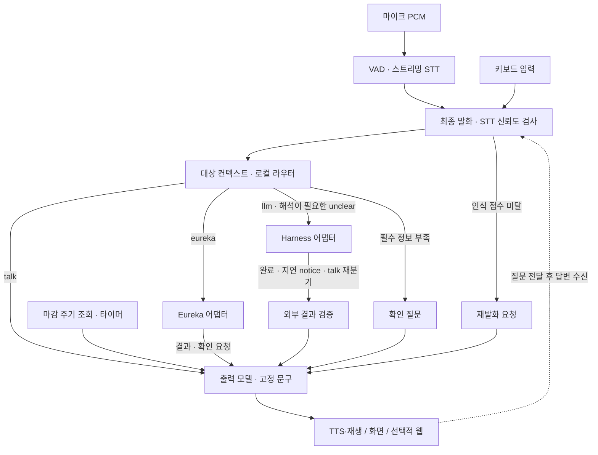

# DeskPet Pipeline

**한국어 발화가 들어온 뒤 어떤 요청을 기기에서 처리하고, 어떤 요청을 서비스에 맡기며, 언제 사용자에게 응답할지 결정하는 Swift 런타임입니다.** 하나의 제품에서 한국어 음성 인식, 온디바이스 라우터, 로컬 대화 모델, 업무 API, 음성 합성과 장치 출력을 연결합니다. `DeskPetPipeline` 라이브러리는 이 실행 구조를 제공하고, `deskpet-demo`는 모의 어댑터와 실제 모델을 연결하는 실행 파일입니다.

예를 들어 “보고서 마감 언제야?”는 라우터가 추출한 업무 대상을 바탕으로 Eureka를 조회합니다. “관련 PR의 리뷰를 요약해 줘”는 Harness가 처리하는 동안 접수 음성을 먼저 내보낼 수 있습니다. “너무 지쳤어”는 로컬 출력 모델로 전달합니다. 인식이 불확실하거나 정보가 부족하면, 무엇이 불확실한지에 따라 재발화나 대상 확인을 요청합니다.

## 입력, 라우팅과 재진입



- **스트리밍 입력.** VAD가 음성 구간을 나누고 STT가 순서대로 프레임을 소비합니다. 중간 전사 결과는 진단 이벤트로 내보내고, 최종 전사만 요청으로 등록합니다. 입력 epoch가 이미 바뀌었거나 인식 신뢰도가 기준에 못 미치면 외부 업무를 호출하기 전에 걸러냅니다. 키보드 모드는 마이크·VAD·STT를 건너뜁니다.
- **학습한 예측과 실행 결정.** Qwen3.5 0.8B의 LoRA 통합 백본과 전용 헤드에서 의도·작업·우선순위를 분류하고, 업무·단계·체크포인트·기한의 원문 구간을 추출합니다. `Task`·`Note` 생성 헤드는 필요한 작업에서만 사용합니다. `Operation`은 `eureka` 의도에서만 활성화됩니다. Swift는 원본 예측과 점수, Unicode 구간을 보존하면서 헤드를 마스킹하고 필수 인자와 신뢰도를 확인해 `RouteDecision`을 만듭니다. 24개 작업 매핑과 각 필드의 의미는 [라우터 모델 계약](docs/router-model-contract.md)에 있습니다.
- **대상별 대화 맥락.** 같은 업무를 이어 말하면 해당 대상의 최근 사용자·어시스턴트 턴을 학습 때 사용한 role 형식으로 전달합니다. 대상을 바꾸거나 맥락이 만료되면 이전 업무의 턴을 넘기지 않습니다. “그거 내일로 미뤄줘”에서 지시 대상이 유효할 때만 이어받고, 기한 표현은 원문을 유지한 채 한국 시간 기준으로 정규화합니다. 일반 대화의 출력 맥락도 별도로 관리합니다. [라우터 컨텍스트](docs/router-context.md)
- **입구와 별도로 들어오는 이벤트.** 마감 조회는 주기적으로 독립 실행되며, 대화 중이거나 질문 답을 기다릴 때는 새 알림을 끼워 넣지 않습니다. 기본 5분 주기로 24시간 이내의 후보를 조회해 가까운 한 건을 고르고, 실제 전달된 알림과 연기 이력을 기록합니다. 네이티브 실행은 타이머, 알림 연기, 직전 응답 반복, 발화 중단 같은 명령을 로컬 규칙으로 처리할 수 있습니다.

## 요청 경로

| 경로 | 실행 방식 | 이어지는 상태 |
| --- | --- | --- |
| **Eureka** | 조회·등록·기한 변경 등 정형 요청을 형식화하여 Eureka 어댑터에 직접 제출 | 결과 또는 확인 질문. 요청과 작업 ID를 보존 |
| **Harness** | PR 검토, 복합 요청, 해석이 필요한 발화를 Harness에 위임 | 결과, 확인 요청, 지연 notice, 일상 대화 재분기 |
| **로컬 대화** | Qwen3.5 2B 출력 모델에서 한국어 답변 생성 | TTS와 화면에 전달 |
| **재질문** | 대상·필수 값이 부족하면 확인 문구를 생성. STT 저신뢰는 라우팅 전에 재발화로 처리 | 질문이 사용자에게 전달된 뒤 답변 대기 |
| **리마인더·타이머** | 주기 조회 또는 로컬 타이머에서 출력 요청 생성 | 실제 전달 이력, 확인 또는 다시 알림 |

`--direct-llm`은 모델 라우터를 로드하지 않고 Harness로 전달하는 비교용 실행 모드입니다. 같은 음성·출력 경로에서 라우팅 유무에 따른 처리 시간과 프로세스 메모리를 비교할 수 있습니다. [성능 기록 형식](docs/model-performance.md)

## 비동기 모듈과 자원 제어

`DeskPetPipeline` actor가 대화의 최신 턴, 요청 기록과 전달 상태를 소유합니다. 각 `PipelineModule`은 자신의 모델 또는 어댑터를 갖고, 입력이 있는 모듈은 제출 루프 하나와 완료 처리 루프 하나를 실행합니다. 라우터가 외부 호출을 끝까지 기다리는 동안 전체 입력이 멈추는 구조를 피하기 위해, Eureka와 Harness는 입력 대기 큐 없이 각 모듈에 직접 요청을 제출하고 완료 큐에서 응답을 처리합니다.

| 실행 경계 | 순서와 동시성 |
| --- | --- |
| **STT·장치** | 발화 프레임과 장치 명령은 순서를 보존합니다. 음성 재생은 한 번에 한 작업을 처리합니다. |
| **모델·API** | 모듈마다 진행 중 호출 수를 제한합니다. 처리 슬롯이 가득 찬 외부 API 경로는 `API_BUSY`를 돌려줍니다. 서로 독립된 요청은 완료된 것부터 다음 모듈에 넘깁니다. 라이브러리 기본값은 Eureka와 Harness 각각 최대 8건입니다. |
| **GPU** | 전담 OS 스레드가 `GPUOperation`의 제출, 비동기 결과 확인, 취소 신호 전달을 담당합니다. 모델의 소유권은 각 어댑터에 있고, 연산은 네이티브 백엔드가 실행합니다. 기본 데모는 이 경계를 mock 연산으로 시험합니다. |
| **메모리** | 유한한 `Mailbox`가 요청, STT 프레임, PCM을 보관합니다. 요청 등록은 메일박스 슬롯을 예약한 뒤 상태를 확인하고 커밋합니다. 등록이 취소되면 예약을 해제합니다. TTS가 내보낸 PCM은 재생 쪽이 소비할 때까지 생산을 늦출 수 있습니다. |
| **취소** | 일반 대화는 새 턴의 유효성을 검사하고 이전 결과가 다시 말해지지 않게 합니다. 모듈 종료 시 취소를 전달하고, 이미 제출한 외부 요청의 확인된 결과 또는 결과 불명 상태를 반영합니다. |

네이티브 실행에서 활성화하는 비동기 Harness 접수는 장시간 작업에 “확인해 볼게요”를 먼저 출력합니다. 작업은 백그라운드에서 진행할 수 있어 후속 발화를 받아도 유지되며, 완료 결과는 다른 음성이 끝난 뒤 전달할 수 있습니다. 완료 결과와 WebSocket notice가 도착하면 `ExternalInjectionModule`이 요청·턴 상관관계, 중복, 크기, 출력 문구를 검사합니다. 일상 대화로 재분류된 결과는 로컬 출력 큐로 되돌립니다. [모듈 설계](docs/concurrency-design.md)

## 업무 완료와 사용자 전달

- `requestId`는 대화 속 요청을, `operationId`는 외부 작업을, `outputId`는 사용자에게 보낸 출력을 식별합니다. `record(requestId:)`에서 업무 결과와 전달 결과를 각각 조회할 수 있습니다.
- 모델 출력은 TTS, PCM 재생, 화면과 선택적 웹 경로로 전달됩니다. 실제 재생 완료를 스피커에서 확인합니다. 합성이나 재생이 실패하면 동일한 업무 결과를 화면 텍스트로 전달하며, 출력 오류 때문에 업무를 다시 수행하지 않습니다.
- 확인 질문은 음성 또는 화면을 통해 사용자에게 전달된 뒤 대기 상태가 됩니다. Harness 질문은 `pendingId`와 질문 문구 등을 담은 `question_delivered`를 보고합니다. 후속 발화는 대상·턴·확인 상태를 검사해 올바른 요청에 연결합니다.
- 쓰기 결과가 불명확하면 `unknown`으로 기록하고 `reconcile`에서 같은 작업 ID의 상태를 조회합니다. 모호한 응답을 성공으로 처리하거나 쓰기 요청을 재전송하지 않습니다.

## PR 검토 도중 다른 발화가 들어오는 경우

| 시점 | 파이프라인이 하는 일 |
| --- | --- |
| “보고서 PR 리뷰를 요약해 줘.” | 최종 전사의 신뢰도를 검사하고 라우터의 `llm` 경로를 확정합니다. Harness에 작업을 제출하고 접수 음성을 출력합니다. |
| Harness가 GitHub를 읽는 중 다른 발화가 들어옴 | 스트리밍 STT와 라우팅은 계속 요청을 받습니다. 새 대화가 로컬 답변을 생성하는 동안 기존 Harness 작업은 백그라운드에서 완료될 수 있습니다. |
| 리뷰 요약이 도착함 | 작업 ID와 응답을 맞춰 기록하고, 외부 결과 검증을 거쳐 다른 음성이 끝난 뒤 요약을 전달합니다. 명시적으로 취소된 요청은 새 결과를 발화하지 않습니다. |
| “그 PR 승인해 줘.” | 승인에 필요한 확인 질문을 실제 전달한 뒤 답을 기다립니다. 승인 설명이나 사용자 답변이 이전 또는 다른 요청의 범위를 바꾸지 않도록 pending 정보와 대화 맥락을 사용합니다. |

## 실행

Swift 6과 macOS 13 이상을 기준으로 합니다. 패키지는 형제 디렉터리 `../deskpet-hardware/swift`를 참조합니다. [DeskPet Hardware](https://github.com/hansung-capstone-team-8-new-line/deskpet-hardware)

```sh
swift test
swift run deskpet-demo
swift run -c release deskpet-demo --module-demo
```

모의 데모는 합성 입력과 모의 모델·서비스로 큐, 라우팅과 출력까지 확인합니다. 실제 모델을 쓰려면 Apple Silicon Mac에서 모델과 런타임을 준비하고, Harness의 `.env`에 `HARNESS_WS_TOKEN`, `GITHUB_TEST_REPO`, `GITHUB_TEST_PR` 및 연동 설정을 채웁니다. 기본 Harness 위치는 형제 폴더 `LLM_test`입니다. 다른 경로는 `Models/native.local.json`의 `harnessEnvFile`과 `DESKPET_HARNESS_DIR`로 맞춥니다. [네이티브 모델 준비](docs/native-models.md)

```sh
./run.command --check
./run.command
# 키보드로 입력
./run.command --keyboard
```

Mac 실행은 기기의 마이크·스피커와 하드웨어 모의 화면을 사용합니다. Jetson에서 모델 빌드와 실제 장치까지 함께 띄우는 진입점은 [DeskPet Product](https://github.com/hansung-capstone-team-8-new-line/deskpet-product)에 있습니다.

## 코드와 검증 문서

| 위치 | 내용 |
| --- | --- |
| [Pipeline.swift](Sources/DeskPetPipeline/Pipeline.swift), [Module.swift](Sources/DeskPetPipeline/Module.swift) | 요청 상태, 모듈 수명, 출력 완료 |
| [Adapters.swift](Sources/DeskPetPipeline/Adapters.swift), [인터페이스 표](docs/interface-map.md) | STT·라우터·Eureka·Harness·출력·장치의 교체 경계 |
| [NativeModels.swift](Sources/DeskPetPipeline/NativeModels.swift), [GPUExecutor.swift](Sources/DeskPetPipeline/GPUExecutor.swift) | Swift/C ABI와 네이티브 모델 실행 |
| [ExternalInjection.swift](Sources/DeskPetPipeline/ExternalInjection.swift), [ServerHarness.swift](Sources/DeskPetPipeline/ServerHarness.swift) | 외부 결과 검증과 Harness 연결 |
| [로컬 모델](Models/README.md), [검증](docs/validation.md) | 가중치 준비, 모의 시험과 실제 연결의 검증 범위 |
