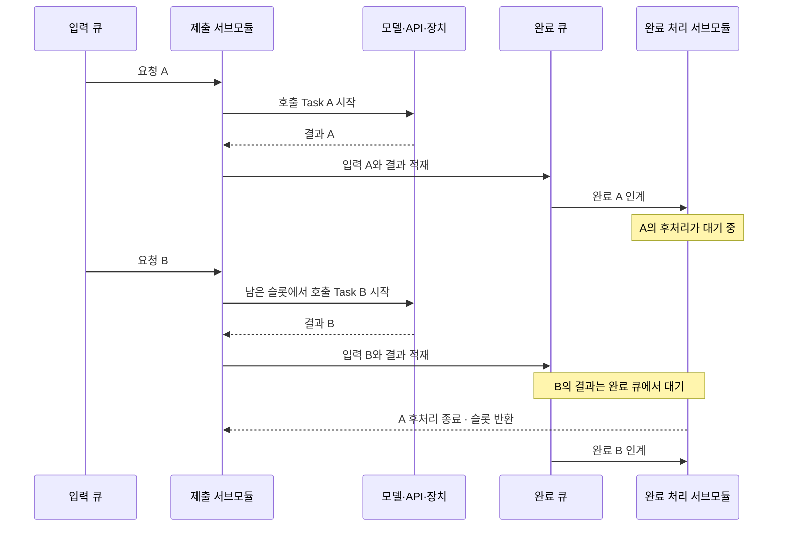
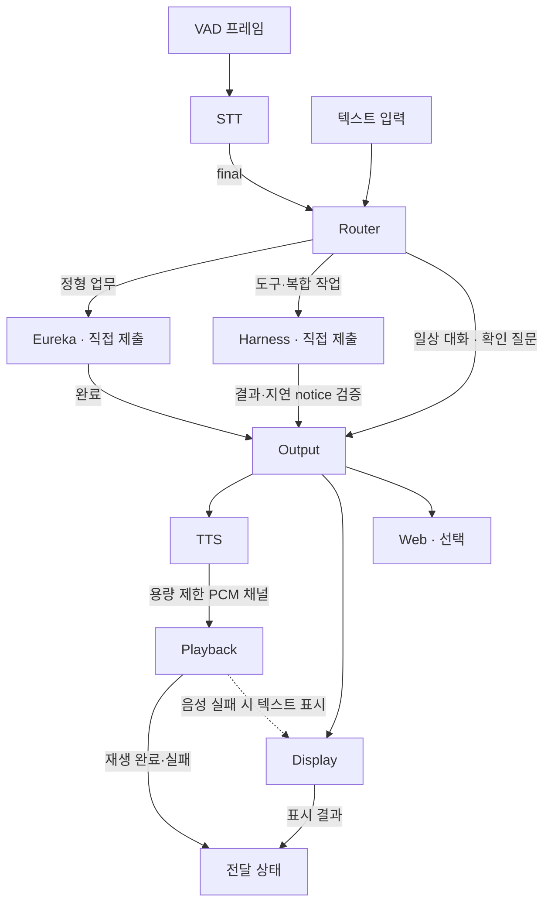

# DeskPet Pipeline

DeskPet의 Swift 음성 런타임입니다. 스트리밍 STT, 온디바이스 라우터, Eureka·Harness 호출, 응답 생성과 장치 출력을 역할별 모듈로 실행합니다. **모듈 하나의 실행 구조는 제출 서브모듈과 완료 처리 서브모듈의 2단계입니다.** 두 서브모듈 사이에는 용량이 제한된 완료 큐가 있어, 앞선 요청의 후처리가 기다리는 동안에도 남은 슬롯으로 다음 요청을 제출할 수 있습니다. 이 구조를 모듈마다 반복하므로 STT가 새 입력을 처리하는 동안 다른 요청의 API 호출, TTS, 화면 갱신을 진행할 수 있습니다.

## 모듈 내부의 2단계 서브모듈



| 경계 | 하는 일 | 다음 작업이 진행되는 조건 |
| --- | --- | --- |
| **제출 서브모듈** | 입력 `Mailbox`에서 꺼낸 작업을 `submit`에 전달합니다. 호출별 Task가 모듈 자원에 주입된 `execute(input, resource)`를 실행하고, 입력과 성공값 또는 오류를 완료 큐에 적재합니다. | 처리 슬롯이 남아 있으면 앞선 호출의 반환이나 후처리를 기다리지 않고 다음 입력을 받습니다. |
| **완료 큐** | 호출 Task가 반환하는 순서로 완료 항목을 받습니다. 모듈의 동시 처리 상한과 같은 용량을 사용합니다. | 완료한 호출도 후처리가 끝날 때까지 슬롯을 점유하므로, 미처리 완료 항목이 늘어나면 새 제출량도 함께 제한됩니다. |
| **완료 처리 서브모듈** | 독립 루프가 완료를 한 건씩 받아 `process(input, result)`를 실행합니다. 예를 들어 Router는 판단을 현재 대화 맥락에 반영한 뒤 후속 모듈에 전달하고, Playback은 물리 재생 결과를 기록합니다. | 후처리가 끝나면 호출을 `operations`에서 제거하고 슬롯을 반환합니다. 다음 단계에는 해당 모듈의 입력 큐나 직접 제출 API로 전달합니다. |

`DeskPetPipeline` actor는 전체 요청과 대화 상태를 조정합니다. 각 `PipelineModule` actor는 자기 역할의 자원, `submissionLoop`, `completionLoop`를 소유합니다. **현재 구현의 서브모듈 경계는 이 두 루프와 주입된 `execute`·`process`입니다.** 설계 문서의 `SubmissionSubmodule`·`CompletionSubmodule`은 이 책임을 별도 Swift 객체로 옮기는 설계의 타입 이름입니다. [현재 Module.swift](Sources/DeskPetPipeline/Module.swift) · [서브모듈 설계](docs/concurrency-design.md)

**Eureka와 Harness의 직접 제출.** Router 완료부가 각 API 모듈의 `submit`을 호출합니다. 두 모듈은 `input: nil`로 생성되므로 입력 큐를 기다리는 소비 루프 없이 호출 Task에 바로 진입합니다. 내부 완료 큐와 완료 처리 루프를 거쳐 응답을 반영하는 방식은 동일합니다. 기본 동시 처리 상한은 API별 8건이며, 가득 차면 외부 호출을 시작하기 전에 `API_BUSY`를 반환합니다. [모듈 조립과 API 제출](Sources/DeskPetPipeline/Pipeline.swift) · [기본 설정](Sources/DeskPetPipeline/Runtime.swift)

## 모듈 간 병렬 실행과 순서 제약



| 동시에 진행하는 작업 | 유지하는 순서·의존성 |
| --- | --- |
| **캡처/VAD와 STT** | 캡처 루프는 발화가 끝나기 전부터 프레임을 공급합니다. STT는 호출 슬롯 하나로 프레임 순서를 보존하고, `partial`은 진단으로, `final`은 Router로 보냅니다. 장치가 재생 전에 무효화한 입력 epoch의 전사는 폐기합니다. |
| **Router·Output과 외부 API** | Router와 Output은 기본 16개 호출 슬롯을 가지며, Eureka와 Harness는 독립 슬롯과 완료 큐를 사용합니다. 요청 A의 Harness 응답을 기다리는 사이 요청 B의 라우팅이나 응답 생성이 진행될 수 있습니다. 같은 대화에 관한 상태 갱신에는 최신 턴과 컨텍스트 검사를 적용합니다. |
| **Display·Web과 TTS·Playback** | Output 완료부는 각 입력 큐에 전달하고 화면·웹의 확인 응답을 기다리지 않습니다. TTS가 첫 PCM을 준비하면 Playback이 소비를 시작하고, 이후 청크는 생산과 소비가 겹칩니다. Playback과 Display는 각각 한 작업씩 처리합니다. |
| **재생 큐 포화와 나머지 출력** | 재생 대기 큐(기본 2건)나 PCM 채널(기본 4청크)이 차면 TTS 생산자가 빈자리를 기다립니다. 이 동안 Display와 Web은 각자의 큐에서 계속 처리합니다. 반대로 STT 프레임을 수용할 수 없으면 해당 발화를 무효화해 불완전한 입력으로 업무를 실행하는 일을 막습니다. |

모듈 간에는 여러 요청의 실행과 대기가 겹치고, 모듈 안에서는 실행 호출과 완료 후처리가 겹칩니다. **동일 요청의 데이터 의존성은 유지됩니다.** Router는 해당 최종 전사가 있어야 실행하고, Playback은 해당 출력의 첫 PCM이 필요합니다. 기본 음성 전달 완료는 스피커가 물리 재생 종료를 확인한 뒤 기록됩니다. 화면 표시 확인이 느려도 음성 완료를 먼저 대화 맥락에 반영할 수 있습니다. Web은 전달 완료 판정과 별개의 소비자입니다. [동시성 회귀 테스트](Tests/DeskPetPipelineTests/ConcurrencyTests.swift)

### 실제 요청에서 겹치는 구간

1. 요청 A가 PR 요약으로 분기하면 Harness에 작업을 제출합니다. 네이티브 실행의 비동기 접수 모드에서 Output은 같은 요청의 접수 안내를 별도 출력으로 보낼 수 있습니다.
2. Harness 응답이 대기 중일 때 요청 B를 입력하면 Router와 Output은 B를 처리합니다. A가 백그라운드 토큰으로 유지되는 동안 TTS·Playback은 준비된 B의 음성을 출력할 수 있습니다.
3. A의 결과가 늦게 도착하면 `ExternalInjectionModule`에서 요청·턴 상관관계, 크기, 중복을 확인합니다. B의 음성이 재생 중이면 A의 결과 전달은 그 재생 뒤로 이어집니다. 명시적으로 취소한 요청은 새 결과 발화 대상에서 제외합니다. [비동기 접수 회귀 테스트](Tests/DeskPetPipelineTests/RuleBypassAndAsyncTests.swift)

## GPU 제출, 네이티브 실행, 결과 회수

라우터와 출력 모델은 자신이 호출할 모델을 참조하는 `GPUOperation`을 만듭니다. `GPUExecutor`의 전담 OS 스레드는 호출을 제출하고 `GPUCompletion`을 받아 준비 여부를 확인합니다. 앞선 호출의 완료가 대기 중이어도 다음 호출을 제출할 수 있고, 뒤에 제출한 작업이 먼저 준비되면 해당 호출에 먼저 결과를 반환합니다. 모듈의 완료 서브모듈은 돌려받은 결과를 업무 상태와 후속 출력으로 변환합니다.

| 계층 | 실행 및 수명 |
| --- | --- |
| **Swift 모듈** | Swift Task와 제한된 호출 슬롯으로 접수량과 완료 처리를 제어합니다. |
| **GPUExecutor** | 한 OS 스레드에서 제출과 비차단 완료 조회를 수행합니다. 호출자가 취소돼도 백엔드가 종료를 보고할 때까지 실행 슬롯과 참조를 유지합니다. |
| **네이티브 백엔드** | C ABI가 작업 핸들을 즉시 반환합니다. 기본 백엔드는 모델 인스턴스별 worker가 자체 큐를 순서대로 처리합니다. 실제 Metal/CUDA 커널의 동시 실행 여부는 백엔드와 장치에 달려 있습니다. |

[GPUExecutor.swift](Sources/DeskPetPipeline/GPUExecutor.swift) · [C ABI](native/backend.cpp) · [네이티브 worker](native/runtime.hpp)

## 라우팅과 요청 수명

- **라우터 계약.** Qwen3.5 0.8B의 LoRA 백본과 전용 헤드가 의도·작업·우선순위, 업무·단계·체크포인트·기한의 원문 구간 등을 반환합니다. Swift는 원본 예측과 점수를 보존하고, 의도별 마스킹과 필수 값 검사를 적용해 `RouteDecision`을 구성합니다. `eureka`는 24개 작업과 정형 경로에, `llm`은 Harness에, `talk`는 로컬 출력에 연결합니다. STT 신뢰도가 낮으면 재발화를 요청하고, 정보가 부족하면 필요한 대상을 묻거나 Harness에서 의도를 해석합니다. [라우터 계약](docs/router-model-contract.md) · [대상별 컨텍스트](docs/router-context.md)
- **요청과 전달 상태.** `requestId`, `operationId`, `outputId`로 대화 요청, 외부 작업, 전달 결과를 연결합니다. TTS 또는 재생이 실패하면 같은 결과를 화면 텍스트로 보냅니다. 쓰기 결과가 불명확하면 `unknown`을 기록하고 같은 작업 ID로 상태를 조회합니다.
- **후속 이벤트.** 질문이 음성 또는 화면에 전달되면 답변 대기를 시작하고, Harness 질문은 `question_delivered`로 보고합니다. 마감 조회와 타이머는 발화 입력과 별도로 Output에 작업을 넣습니다. 진행 중 발화나 확인 질문에는 새 마감 알림을 끼워 넣지 않습니다.
- **종료.** 새 제출을 멈추고 호출 Task에 취소를 전달한 뒤, 완료 큐를 비워 외부 작업의 확인·미확인 상태를 반영합니다. GPU 작업은 백엔드가 물리 완료를 반환하면 회수합니다.

## 실행과 검증

Swift 6과 macOS 13 이상이 필요합니다. Swift 패키지가 `../deskpet-hardware/swift`를 참조하므로 Hardware를 형제 디렉터리에 배치합니다. [DeskPet Hardware](https://github.com/hansung-capstone-team-8-new-line/deskpet-hardware)

```sh
swift test
swift run deskpet-demo
swift run -c release deskpet-demo --module-demo
```

| 확인할 동작 | 검증 진입점 |
| --- | --- |
| A의 완료 처리 중 B를 제출하고 B의 완료를 큐에 보관 | `submissionAndCompletionAreIndependentSubmodules` · [ModuleTests.swift](Tests/DeskPetPipelineTests/ModuleTests.swift) |
| 느린 STT·API·화면·재생이 다른 모듈의 진행을 막는지, 큐 포화에서 어떻게 동작하는지 | [ConcurrencyTests.swift](Tests/DeskPetPipelineTests/ConcurrencyTests.swift) |
| 전담 스레드 하나에서 GPU 작업을 제출하고 빠른 완료부터 반환하는지, 취소 후 슬롯을 언제 해제하는지 | [ModuleTests.swift](Tests/DeskPetPipelineTests/ModuleTests.swift) |
| 8개 세션 × 32건에서 요청, 전달, 음성 완료가 연결되는지 | `--module-demo` · [mock 검증 기록](docs/validation.md) |

`--module-demo`의 완료 수와 스레드 수는 모의 모델과 장치를 사용한 파이프라인 검증 지표입니다. 런타임 상태는 `pipeline.snapshot()`의 입력 큐 깊이, `inFlight`, `completedQueue`와 `gpu.snapshot()`의 `submitted`, `completed`, `outstanding`으로 확인할 수 있습니다.

실제 모델은 Apple Silicon Mac에서 설정을 준비한 뒤 `./run.command --check`와 `./run.command`로 실행합니다. `--keyboard`는 텍스트 입력, `--direct-llm`은 라우터를 로드하지 않는 비교 모드입니다. Harness 인증과 대상 설정은 네이티브 모델 준비 안내를 따릅니다. [모델·서비스 설정](docs/native-models.md) · [성능 기록](docs/model-performance.md) · [Jetson 통합 실행](https://github.com/hansung-capstone-team-8-new-line/deskpet-product)
