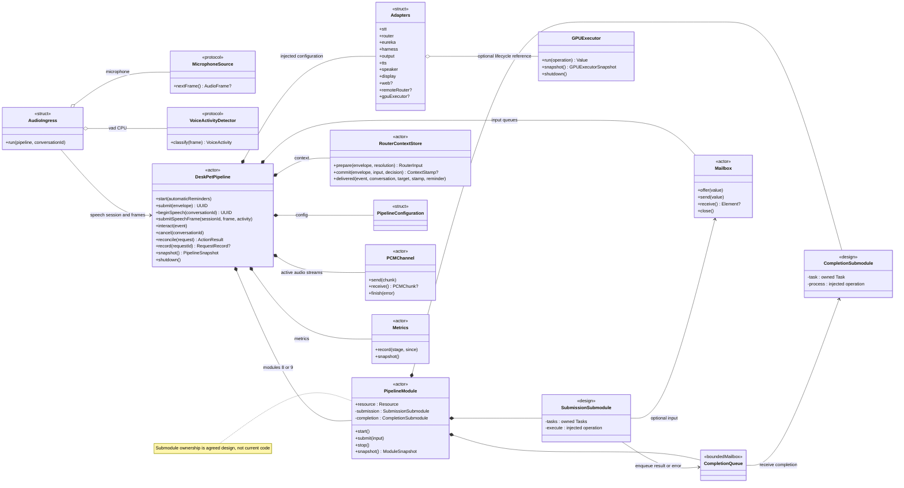
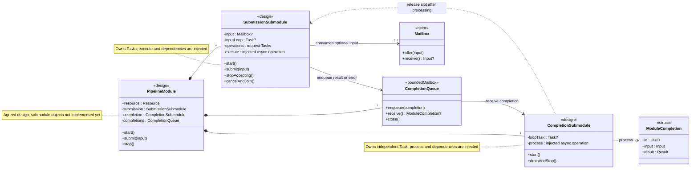
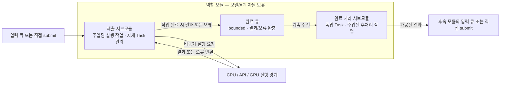
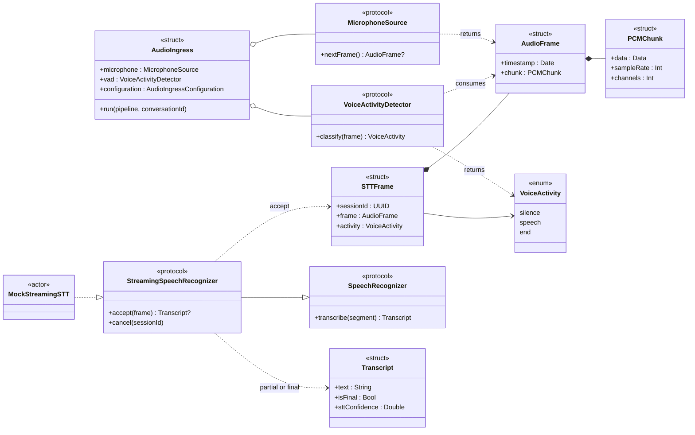
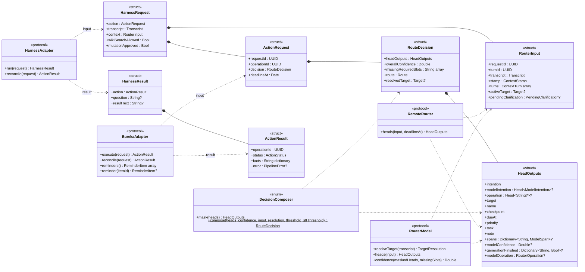
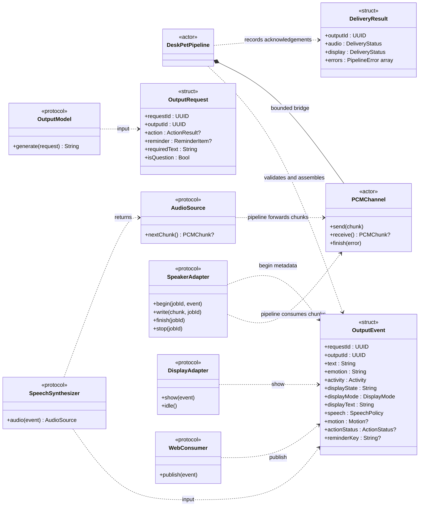
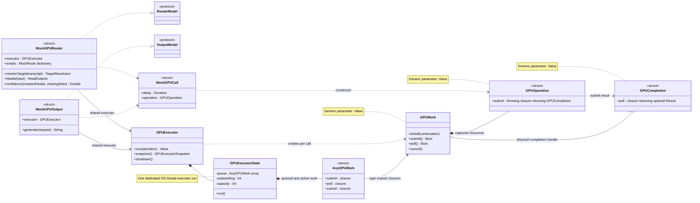

# DeskPet Pipeline Class Diagrams

작성일: 2026-10-04. 구조도 갱신: 2026-10-05. 기준 코드: `84d52f9`의 `Sources/DeskPetPipeline/`.
이 문서는 현재 구현의 통합 인터페이스와 2026-10-05 합의한 서브모듈 변경 설계를 함께 표현한다. 1·2절의 서브모듈 소유 구조는 변경 설계이며 아직 코드에 반영되지 않았다. 실제 모델·HTTP·장치 구현은 adapter로 연결하는 단계다.
메서드는 통합에 필요한 항목을 중심으로 표시했으며, 정확한 Swift 시그니처와 접근 수준은 아래 연결된 소스가 기준이다.

## 읽는 방법

- `<<design>>`은 합의한 미구현 설계 타입이며 `<<boundedMailbox>>`는 내부 완료 큐의 역할이다.
- `<<actor>>`, `<<struct>>`, `<<protocol>>`, `<<enum>>`은 실제 Swift 타입 종류다. 클래스 다이어그램 안에서도 이 구분을 유지한다.
- `*--`는 포함·관리, `o--`는 주입된 자원의 보유, `-->`는 참조, `..>`는 사용 의존성, `..|>`는 protocol 구현, `--|>`는 protocol 상속이다.
- 관계선은 소유권·타입 의존성을 나타낸다. 순차 실행이나 스레드 배치를 뜻하지 않는다.
- generic 타입의 매개변수는 본문에 적는다. `?`는 선택 값이며, 메서드의 async/throws는 각 protocol 설명과 코드에서 확인한다.
- 구현되어 있는 protocol과 mock을 기준으로 작성했다. 모델 runtime과 장치 backend의 내부 클래스는 담당자가 구현 후 추가한다.

공개 adapter의 입력/결과 메서드는 `async throws`다. 예외적으로 `StreamingSpeechRecognizer.cancel`과 `SpeakerAdapter.stop`은 `async`이며 throws가 없다.
`GPUExecutor.run`은 `async throws`, `shutdown`은 `async`, `snapshot`은 동기 메서드다. actor의 격리 메서드는 외부 호출 시 await가 필요하다.

## 1. 전체 구조와 소유권

`DeskPetPipeline`은 모듈 조립, 요청·업무·전달 상태, 대화 context와 후속 경로를 조정한다.
각 역할 모듈은 자원을 보유하고 두 서브모듈의 수명을 조정한다. 전체 그림의 서브모듈 구성은 변경 설계이며, 기준 구현은 모듈이 Task를 직접 관리한다.
실제 구현에서 입력 Mailbox는 pipeline이 생성하고 모듈이 참조하며, 완료 Mailbox는 모듈이 생성한다.
`Adapters`도 자원 참조를 유지하므로 자원 보유 관계를 독점 소유나 참조 개수 1로 해석하지 않는다.

STT·Router·Eureka·Harness·Output·TTS·Playback·Display가 기본 8개 모듈이며, Web이 설정되면 9개가 된다.
AudioIngress는 외부에서 `run`을 실행하는 캡처 경계다. 리마인더 polling은 현재 pipeline 내부 Task다.
STT/TTS 실행 위치는 추후 측정으로 정하며, Router/Output의 GPU 경계는 현재 mock이다.

## 2. 공통 모듈과 제출·완료 처리 — 합의한 변경 설계

이 절은 2026-10-05 합의한 변경 설계다. `SubmissionSubmodule`과 `CompletionSubmodule`은 설계상 이름이며 아직 Swift 타입으로 구현되지 않았다. 그림의 메서드 이름도 책임을 설명하는 설계 인터페이스로, 기존 공개 protocol을 변경한 것이 아니다.

- 역할 모듈은 자원, 두 서브모듈, 둘 사이의 완료 큐를 보유하고 생성·시작·종료를 조정한다. 모듈이 Task를 직접 보유하지 않는다.
- 제출 서브모듈이 입력을 받고 외부에서 주입된 실행 작업을 수행한다. 비동기 실행 경계에서 반환된 결과·오류를 받아 완료 큐에 넣는다. 앞선 호출의 응답 대기 때문에 다른 준비된 호출을 일괄 정지시키지 않으며, 허용된 in-flight 상한과 순서 제약을 지킨다.
- 완료 처리 서브모듈은 독립 Task로 완료 큐를 계속 소비하며 주입된 후처리 작업을 실행한다. 두 서브모듈의 의존성은 필요한 자원·상태·전달 경계로 좁혀 각각 주입한다.
- 완료 처리 뒤에 공통 출력 큐를 추가하지 않는다. 후속 모듈이 입력 큐를 가지면 그 큐에 전달하고, 직접 제출 방식이면 해당 제출 인터페이스를 호출한다.
- 큐 소비 방식에서 제출 서브모듈은 입력 루프 Task를 관리한다. Eureka/Harness도 제출 서브모듈을 갖지만 입력 큐나 상주 입력 소비 Task 없이 직접 `submit`을 받고 호출별 Task를 관리한다. 완료 처리 Task와 내부 완료 큐는 유지한다.
- 호출 슬롯은 후처리 완료까지 유지하고 완료부가 슬롯을 해제하도록 연결한다. 이 제어 신호는 후처리 뒤에 결과 큐를 추가한다는 뜻이 아니다.
- 객체 생성 시 자동 실행하지 않는다. `start`로 실행을 시작하고, 종료는 신규 제출 중단 → 진행 중 호출 취소·완료 정리 → 완료 큐 drain → 완료 처리 종료 순서로 조정한다. Swift Task는 전용 OS 스레드가 아니며 GPU는 기존 전담 OS 스레드 경계를 유지한다.

**현재 구현과의 차이:** 현재 `PipelineModule`은 `submissionLoop`, `completionLoop`, `operations`, `execute`, `process`를 직접 보유한다. 변경 설계에서는 제출 관련 Task와 실행 작업을 제출 서브모듈로, 완료 루프 Task와 후처리 작업을 완료 처리 서브모듈로 옮긴다. 현재 단계별 업무 로직이 중앙 `DeskPetPipeline`에 집중된 문제는 별도의 책임 분리 검토 사항이며, 이번 문서 수정으로 코드가 변경되지는 않았다.

| 모듈 키 | Input | Resource | Output | 입력 방식 |
| --- | --- | --- | --- | --- |
| `stt` | `AudioJob` | `any SpeechRecognizer` | `Transcript?` | `sttQueue`; frame 순서 유지 |
| `router` | `Job` | `any RouterModel` | `(RouterInput, RouteDecision)` | `routerQueue` |
| `eureka` | `Job` | `any EurekaAdapter` | `HarnessResult` | 직접 `submit`; API `ActionResult`를 공통 완료형으로 감쌈 |
| `harness` | `Job` | `any HarnessAdapter` | `HarnessResult` | 직접 `submit` |
| `output` | `Job` | `any OutputModel` | `String` | `outputQueue` |
| `tts` | `Job` | `any SpeechSynthesizer` | `Void` | `ttsQueue`; PCM 생성·전달 |
| `playback` | `PlaybackJob` | `any SpeakerAdapter` | `Bool` | `playbackQueue`; 실제 재생 완료 |
| `display` | `DisplayCommand` | `any DisplayAdapter` | `Bool` | `displayQueue` |
| `web` | `Job` | `any WebConsumer` | `Void` | 선택적 `webQueue` |

`Job`, `AudioJob`, `PlaybackJob`, `DisplayCommand`는 pipeline 내부 private 타입이다.
타 파트는 공개 protocol의 요청/결과 타입에 맞춰 구현한다. `PipelineModule`, `Mailbox`, `ModuleControl`도 패키지 내부 타입이다.

## 3. 음성 입력·STT 통합 인터페이스

캡처/VAD 프레임은 `DeskPetPipeline.beginSpeech`와 `submitSpeechFrame`을 통해 STT 입력에 전달된다.
Streaming adapter는 `StreamingSpeechRecognizer`를 구현한다. `Adapters.stt`의 선언 타입은 호환용 `SpeechRecognizer`이며 실제 streaming 구현을 runtime에 확인한다.
발화 종료를 기다리며 입력을 모으지 않고 speech frame을 계속 전달한다. TTS 재생 중에도 캡처한다.
partial은 진단용이고 final만 라우팅한다. 프레임 손실·포화로 손상된 발화는 무효화한다.

## 4. 라우터·API 통합 인터페이스

각 head는 `Head<Value>`의 값·개별 confidence로 표현한다.
같은 대상의 context snapshot → typed heads → intention masking → confidence → decision을 pipeline과 `DecisionComposer`가 조립한다.
Eureka/Harness의 HTTP, 인증, MCP, Wiki 검색 등은 해당 adapter 내부에 둔다. `RemoteRouter`는 선택적 fallback 인터페이스다.

`ActionResult`는 operationId를 가지며 requestId는 원래 `ActionRequest`와 내부 Job으로 연결한다. 현재 결과형에 없는 식별자를 가정해 통합하지 않는다.
Harness의 `mutationApproved`는 기본 false이며 변경 도구 승인 여부는 adapter에서도 확인한다.
쓰기 응답이 유실되면 unknown을 보존하고 `reconcile`로 확인한다. Harness의 기본 구현은 `RECONCILIATION_UNAVAILABLE`을 반환하므로 실제 연동 시 구현해야 한다.

## 5. 출력·음성·화면·Web 통합 인터페이스

OutputModel의 반환값은 String이며, 사실·크기 검증과 OutputEvent 조립은 pipeline이 담당한다.
TTS는 AudioSource를 반환하고 pipeline의 TTS 처리가 chunk를 PCMChannel에 공급한다. Playback 처리가 chunk를 꺼내 SpeakerAdapter에 전달한다.
그림의 AudioSource/SpeakerAdapter와 PCMChannel 관계는 pipeline의 중계를 나타내며 adapter가 channel을 직접 보유한다는 뜻은 아니다.
`finish`는 물리 재생 완료를, `show`는 표시 완료 ack를 기다린다. Web 장애는 업무 결과·음성/화면의 완료 판정에서 격리한다.

Motion은 OutputEvent의 선택 값이다. 현재 독립 MotionModule, ServoAdapter, TouchAdapter 타입은 정의되어 있지 않다.
실제 servo 범위·표정 map·touch 변환은 장치 담당자와 계약을 정하고 InteractionEvent를 `DeskPetPipeline.interact`에 전달한다.

## 6. GPU 디스패처와 모델 소유권

GPUExecutor는 연산 제출·nonblocking 완료 확인·요청자에게 결과 반환을 담당한다.
모델·입력·후처리는 역할 모듈의 Resource에 두며 GPUOperation의 closure가 실제 완료까지 필요한 참조를 유지한다.
`GPUExecutorState`의 run에서 대기 요청과 active 요청을 처리하고, 앞선 요청의 완료를 기다리는 중에도 다음 연산을 제출할 수 있다.
요청자에게 취소를 반환해도 이미 제출된 연산의 자원과 슬롯은 물리 완료까지 유지한다.

현재 모델 자원은 mock fixture다. 실제 runtime 연결 시 모델 adapter가 GPUOperation/GPUCompletion을 구성한다.
CUDA stream/context, TensorRT 등 backend 선택과 실제 GPU 병렬 실행은 runtime의 책임이며 dispatcher가 모델을 관리하지 않는다.
GPUWork에는 외부 requestId 필드가 없고 run별 continuation으로 반환 대상을 연결한다. 업무 requestId 추적은 pipeline에서 유지한다.

## 통합 시 담당 경계

| 담당 | 구현·확인 대상 | 연결 대상 |
| --- | --- | --- |
| 파이프라인·모델 | RouterModel, OutputModel, StreamingSpeechRecognizer, SpeechSynthesizer, GPU 실행 경계 | Adapters와 AudioIngress |
| Eureka/Harness·Web | EurekaAdapter, HarnessAdapter, WebConsumer, 필요 시 RemoteRouter 연동 | ActionRequest/Result, HarnessRequest/Result, OutputEvent |
| 장치 제어 | MicrophoneSource, SpeakerAdapter, DisplayAdapter, touch/servo 구현 | AudioFrame/PCMChunk, OutputEvent, InteractionEvent |

공개 adapter는 Sendable을 만족하고 비동기 호출 취소에 협조한다. blocking native 처리는 GPU 등 전용 실행 경계에 둔다.
요청 접수와 물리 출력 완료를 구분하고 requestId·operationId·outputId·jobId·sessionId를 각 경계에서 유지한다.
Swift 내부 값에는 Codable이 아닌 타입도 있으므로 HTTP/MCP·다른 언어 연동의 wire schema는 [계약 대응표](interface-map.md)와 함께 합의한다.

## 갱신 기준과 소스

protocol 시그니처, payload, 소유 관계 또는 완료 의미가 바뀌면 코드·해당 그림·계약 대응표를 같은 변경에서 갱신한다.
모듈 통합 시 관련 공개 protocol의 성공·실패·취소·지연 응답 fixture를 준비해 확인한다.
1·2절의 서브모듈 구조는 2026-10-05 합의한 변경 설계이고 나머지 인터페이스는 현재 구현 기준이다. 설계를 구현하면 타입명·시그니처와 코드 기준을 함께 갱신한다.

- [Pipeline.swift](../Sources/DeskPetPipeline/Pipeline.swift): 조립, 상태, 완료 처리
- [Module.swift](../Sources/DeskPetPipeline/Module.swift): generic 모듈, 제출·완료 루프
- [Adapters.swift](../Sources/DeskPetPipeline/Adapters.swift): 공개 통합 protocol
- [Contracts.swift](../Sources/DeskPetPipeline/Contracts.swift): 요청·결과·출력·이벤트
- [AudioIngress.swift](../Sources/DeskPetPipeline/AudioIngress.swift): capture/VAD
- [GPUExecutor.swift](../Sources/DeskPetPipeline/GPUExecutor.swift): GPU 제출·반환
- [RouterContext.swift](../Sources/DeskPetPipeline/RouterContext.swift): context와 decision 조립
- [Runtime.swift](../Sources/DeskPetPipeline/Runtime.swift), [PCMChannel.swift](../Sources/DeskPetPipeline/PCMChannel.swift): bounded buffer와 metrics
- [Mocks.swift](../Sources/DeskPetPipeline/Mocks.swift): 교체 대상의 현재 구현
- [Concurrency Design](concurrency-design.md), [Interface Map](interface-map.md): 동작·경계 계약
