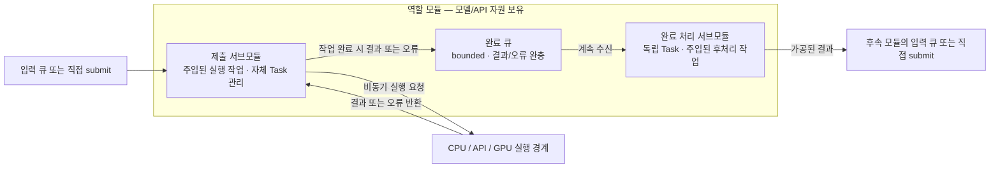

# 모듈과 GPU 실행 경계

2026-09-29 구현 구조와 2026-10-05 합의한 서브모듈 변경 설계를 구분한다. 두 서브모듈 객체가 Task를 소유하는 변경은 아직 미구현이다. 모든 모듈은 자신이 소유한 역할을 독립적으로 처리하며,
필요한 데이터 의존성만 기다린다. 모듈당 실행 워커를 여러 개 만드는 구조는 제거했다.

## 모듈의 소유권과 두 서브모듈



이 절은 2026-10-05 합의한 변경 설계다. `SubmissionSubmodule`과 `CompletionSubmodule`은 설계상 이름이며 아직 Swift 타입으로 구현되지 않았다. 그림의 메서드 이름도 책임을 설명하는 설계 인터페이스로, 기존 공개 protocol을 변경한 것이 아니다.

- 역할 모듈은 자원, 두 서브모듈, 둘 사이의 완료 큐를 보유하고 생성·시작·종료를 조정한다. 모듈이 Task를 직접 보유하지 않는다.
- 제출 서브모듈이 입력을 받고 외부에서 주입된 실행 작업을 수행한다. 비동기 실행 경계에서 반환된 결과·오류를 받아 완료 큐에 넣는다. 앞선 호출의 응답 대기 때문에 다른 준비된 호출을 일괄 정지시키지 않으며, 허용된 in-flight 상한과 순서 제약을 지킨다.
- 완료 처리 서브모듈은 독립 Task로 완료 큐를 계속 소비하며 주입된 후처리 작업을 실행한다. 두 서브모듈의 의존성은 필요한 자원·상태·전달 경계로 좁혀 각각 주입한다.
- 완료 처리 뒤에 공통 출력 큐를 추가하지 않는다. 후속 모듈이 입력 큐를 가지면 그 큐에 전달하고, 직접 제출 방식이면 해당 제출 인터페이스를 호출한다.
- 큐 소비 방식에서 제출 서브모듈은 입력 루프 Task를 관리한다. Eureka/Harness도 제출 서브모듈을 갖지만 입력 큐나 상주 입력 소비 Task 없이 직접 `submit`을 받고 호출별 Task를 관리한다. 완료 처리 Task와 내부 완료 큐는 유지한다.
- 호출 슬롯은 후처리 완료까지 유지하고 완료부가 슬롯을 해제하도록 연결한다. 이 제어 신호는 후처리 뒤에 결과 큐를 추가한다는 뜻이 아니다.
- 객체 생성 시 자동 실행하지 않는다. `start`로 실행을 시작하고, 종료는 신규 제출 중단 → 진행 중 호출 취소·완료 정리 → 완료 큐 drain → 완료 처리 종료 순서로 조정한다. Swift Task는 전용 OS 스레드가 아니며 GPU는 기존 전담 OS 스레드 경계를 유지한다.

**현재 구현과의 차이:** 현재 `PipelineModule`은 `submissionLoop`, `completionLoop`, `operations`, `execute`, `process`를 직접 보유한다. 변경 설계에서는 제출 관련 Task와 실행 작업을 제출 서브모듈로, 완료 루프 Task와 후처리 작업을 완료 처리 서브모듈로 옮긴다. 현재 단계별 업무 로직이 중앙 `DeskPetPipeline`에 집중된 문제는 별도의 책임 분리 검토 사항이며, 이번 문서 수정으로 코드가 변경되지는 않았다.

## 모듈별 경계

| 모듈 | 소유 자원 | 제출 작업 | 완료 처리 / 후속 경계 | 진행 중 호출 상한 |
| --- | --- | --- | --- | --- |
| STT | `SpeechRecognizer` / `StreamingSpeechRecognizer` | VAD 프레임 또는 호환용 segment 인식 | partial 이벤트 / final 라우터 입력 | 1; 프레임 순서 보존 |
| 라우터 | `RouterModel` | 대상 해소 → context snapshot → heads → masking/confidence | typed decision 검증·context commit·경로 선택 | 기본 16; worker 수가 아님 |
| Eureka | `EurekaAdapter` | 직접 API 호출; 입력 대기 큐 없음 | operation ID 검증·업무 상태 보존·출력 요청 | 기본 8 |
| Harness | `HarnessAdapter` | 직접 API 호출; 실제 LLM/MCP는 adapter 경계 | 결과/질문 검증·업무 상태 보존·출력 요청 | 기본 8 |
| 출력 모델 | `OutputModel` | 응답 생성 연산 | 사실/크기 검사·fallback·TTS/화면/웹 전달 | 기본 16 |
| TTS | `SpeechSynthesizer` / `AudioSource` | 음성 생성·bounded PCM 공급 | 생성 실패 전달; 발화 완료는 재생 모듈에서 판단 | 1 |
| 재생 | `SpeakerAdapter` | PCM 재생 요청 | 물리 완료 ack·delivery 갱신 | 1; 오디오 혼합 없음 |
| 화면 | `DisplayAdapter` | face/text/idle 표시 | 표시 완료 ack·delivery 갱신 | 1; 장치 명령 순서 보존 |
| 웹 | 선택적 `WebConsumer` | 출력 이벤트 전송 | 오류 격리; 음성/화면 완료와 독립 | 1 |

Harness 내부의 LLM Wiki 검색/MCP 도구 실행은 현재 wiki의 adapter 소유권 경계를 유지한다.
실제 Harness 서버의 내부 모듈 구현은 포함하지 않는다. 각 adapter는 비동기 호출과 취소에 협조해야 한다.
blocking 추론이나 장치 함수로 Swift cooperative executor를 막지 않는다.

## GPU 전담 스레드

`GPUExecutor`는 persistent OS 스레드 하나만 만든다. 수행 책임은 연산 제출, 완료 확인,
요청별 결과·오류 반환이다. 모델 선택·업무 상태·출력 후처리·모델 unload 정책은 갖지 않는다.
모델은 각 모듈의 `resource`에 있고, `GPUOperation<Value>`가 필요한 모델/입력 자원을 참조한다.
그 참조는 runtime completion이 확인될 때까지 유지한다.

```swift
let gpu = try GPUExecutor(capacity: 64)
let adapters = Adapters.gpuMocks(executor: gpu)
let pipeline = try DeskPetPipeline(adapters: adapters)
await pipeline.start()
// ... 입력 제출 ...
await pipeline.shutdown()
```

`GPUOperation.submit()`는 전담 스레드에서 연산을 제출하고 즉시 `GPUCompletion` handle을 반환한다.
`poll()`은 해당 스레드에서 결과의 준비 여부를 nonblocking으로 확인한다. 전담 스레드는 먼저 제출된
연산의 완료를 기다리며 정지하지 않고 다른 요청을 제출하며, 준비된 결과를 요청자에게 돌려준다.
현재 completion 조회는 조건 변수와 1ms 간격 확인이며, 실제 런타임의 event 알림으로 교체할 수 있다.

실제 GPU 호출은 `MockGPUCall`이다. 라우터/출력 fixture는 각각 `MockGPURouter`와 `MockGPUOutput`이
소유한다. TensorRT를 비롯한 추론 런타임은 확정하지 않았다. 자체 CUDA stream 병렬 스케줄러,
우선순위/preemption, GPU 커널 실행이나 CPU 계산 성능 비교는 포함하지 않는다.
실제 GPU에서 연산이 겹치는지/직렬 실행되는지는 런타임과 하드웨어의 영역이다.
`GPUExecutor`의 수용 한도는 메모리 제한을 위한 outstanding 상한이며 GPU 병렬도 설정이 아니다.

## VAD / STT

CPU VAD가 speech로 판정한 프레임을 캡처 루프가 바로 STT 입력 큐에 전달한다. 캡처는 추론 완료를
기다리지 않으며 발화 전체 PCM을 보관하지 않는다. `.end`도 같은 큐로 전달해 프레임 순서를 유지한다.
출력 재생 중에도 입력을 읽고 VAD/STT를 진행한다. EOF·캡처 오류·취소 시 미완료 session은 취소한다.

STT의 `accept(STTFrame)`은 partial/final을 반환하며 partial은 업무 실행으로 이어지지 않는다.
호환용 `submitAudio(AudioSegment)`도 남아 있지만 실시간 캡처 경로는 사용하지 않는다.
`MockStreamingSTT`만 합성 UTF-8 fixture를 발화 단위로 모으며 실제 오디오 인식은 하지 않는다.
STT의 CPU/GPU 배치는 Jetson 성능·추론 시간 측정 후 결정하고 TTS도 미정이다.

## 메모리 / 취소 / 종료

- 입력 큐: 기본 16건. STT 큐는 frame 상한 64건과 segment 상한 2건 중 큰 용량으로 생성하되 segment admission은 별도로 2건에 제한한다.
- 진행 중 호출은 완료 처리까지 슬롯을 점유한다. 완료 큐도 같은 슬롯 수로 제한한다. 준비된 결과가 쌓이면 새 제출을 대기시킨다.
- 한 STT 프레임/PCM chunk는 최대 64 KB, 한 발화는 기본 2 MB, playback 대기 2건, PCM channel 4 chunk로 제한한다. 생산자/소비자의 현재 chunk도 메모리 산정에 포함한다.
- 재생 큐가 가득 차면 고정된 TTS 제출 작업 하나가 빈자리를 기다린다. 큐 밖의 대기 playback job/첫 PCM chunk 하나도 메모리 산정에 포함하며, 포화만으로 음성을 버리거나 worker를 추가하지 않는다. 취소 시 대기 job을 회수한다.
- STT 프레임 큐 포화·발화 크기 초과는 오류를 보고하고 해당 발화를 무효화한다. 실제 장치에서 지속 입력을 감당할지는 캡처 backlog와 STT 처리율을 측정해야 한다. AEC는 장치 통합 대상이다.
- GPU 호출 취소는 async 요청자를 먼저 반환시킨다. 이미 실행 중인 연산의 자원/수용 슬롯은 물리 completion까지 유지한다. 런타임이 완료를 영원히 반환하지 않으면 강제 종료를 보장하지 않는다.
- 종료는 신규 입력을 차단하고 호출을 취소한 다음, 모듈 완료 큐를 처리하고 GPU completion을 회수한다. API 변경의 확인/미확인 상태를 보존한다.
- 장치 재생/표시 완료만 assistant 턴으로 저장한다. 음성 완료는 느린 face ack보다 먼저 context에 반영할 수 있다. 웹은 delivery join에 포함하지 않는다.
- 동일 conversation의 새 요청이 이전 요청을 대체하는 freshness 정책과 operation/output/session ID 검증을 유지한다.

## 관측과 검증

`pipeline.snapshot()`은 모듈 입력 큐와 `ModuleSnapshot`의 제출, 완료 처리, 진행 중 호출, 완료 큐를 제공한다.
`gpu.snapshot()`은 제출/완료/outstanding 수와 전담 threadCount를 제공한다.
수치는 진행 중인 시스템에서 얻는 진단 snapshot이므로 모든 모듈에 걸친 원자적 snapshot은 아니다.

```sh
swift test
swift test --sanitize=thread
swift build -c release
.build/release/deskpet-demo --module-demo
```

`--module-demo`는 GPU 호출 mock을 통해 8세션 × 32회(256건)를 처리하는 연결 검증이다.
실제 모델·GPU 처리량 또는 스레드 개수에 따른 성능 비교가 아니다.
